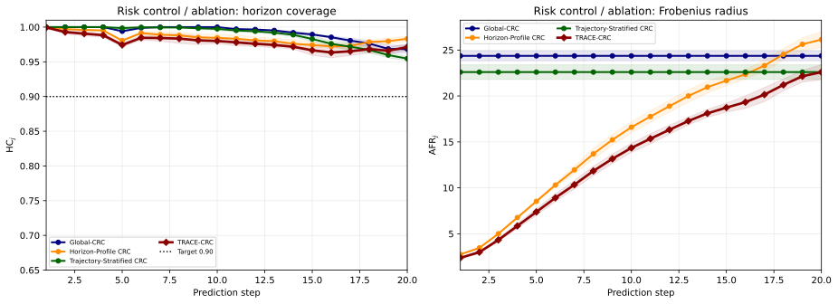

# TRACE-CRC

**Trajectory-Adaptive Conformal Risk Control for Multi-Step Channel State
Information Prediction**

Official implementation and reproducibility artifact for the [COPA 2026 paper](https://proceedings.mlr.press/v329/rezaei26a.html).

TRACE-CRC wraps a pretrained multi-step channel state information (CSI)
predictor with trajectory-aware uncertainty sets. It combines:

- a horizon-dependent error profile;
- trajectory difficulty stratification;
- groupwise split-conformal calibration; and
- Learn-then-Test (LTT) selection for trajectory-level risk control.

Each forecast is a sequence of complex-valued CSI matrices. TRACE-CRC constructs
a Frobenius-norm uncertainty ball around every predicted matrix and controls the
risk that at least one forecast horizon is uncovered.



## Reproducibility Scope

The canonical workflow is:

[`DiU/diu_conformal_all_in_one_reproducibility.ipynb`](DiU/diu_conformal_all_in_one_reproducibility.ipynb)

It performs, in order:

1. deterministic diffusion inference or loading of validated compact caches;
2. five-seed, calibration-only tuning of adaptive and structured baselines;
3. certified structural tuning of TRACE-CRC;
4. parameter freezing before test evaluation;
5. evaluation of all methods on held-out test trajectories;
6. TRACE-CRC inference-seed and random-split robustness analysis; and
7. export of CSV, JSON, NPZ, pickle, SVG, PDF, and LaTeX table artifacts.

The notebook does not use test trajectories for parameter selection.

## Repository Layout

```text
trace-crc/
├── README.md
├── LICENSE
├── THIRD_PARTY_NOTICES.md
├── CITATION.cff
├── requirements.txt
├── scripts/
│   └── validate_repository.py
├── conformal/
│   └── core/                         # Modified vendored LTT implementation
│       ├── LICENSE                   # Original upstream MIT notice
│       └── README.md                 # LTT provenance and modifications
├── data/
│   └── csi/
│       └── README.md                 # Dataset placement and checksum
└── DiU/
    ├── PARAMETER_NOTES.md            # Complete experiment parameters
    ├── config.yml
    ├── inference_helpers.py
    ├── diu_conformal_all_in_one_reproducibility.ipynb
    ├── models/
    │   └── README.md                 # Checkpoint placement and checksum
    └── final_comparison_revision_all_in_one_reproducibility/
        ├── compact_seed_inference/   # Portable five-seed caches
        ├── figures/                  # SVG and PDF figures
        ├── tables/                   # CSV and LaTeX tables
        └── *.json, *.npz, *.pkl      # Reproducibility artifacts
```

## Environment

The artifact was tested with CPython 3.13.7. The exact top-level package
versions are pinned in `requirements.txt`.

```bash
python3.13 -m venv .venv
source .venv/bin/activate
python -m pip install --upgrade pip
python -m pip install -r requirements.txt
python -m ipykernel install --user \
  --name trace-crc \
  --display-name "TRACE-CRC"
```

On Windows PowerShell, activate the environment with:

```powershell
.venv\Scripts\Activate.ps1
```

PyTorch accelerator wheels are platform-specific. The pinned installation is
the environment used for this artifact; users requiring a particular CUDA
build should install the matching PyTorch wheel for their system before
installing the remaining requirements.

## Quick Reproduction From Compact Caches

This is the recommended path for reproducing conformal tuning, metrics, tables,
and figures. It does not require the 195 MB CSI dataset or the 23 MB diffusion
checkpoint.

1. Install the environment.
2. Validate the repository:

   ```bash
   python scripts/validate_repository.py
   ```

3. Start Jupyter from the repository root:

   ```bash
   jupyter lab DiU/diu_conformal_all_in_one_reproducibility.ipynb
   ```

4. Select the `TRACE-CRC` kernel.
5. Confirm that `REBUILD_SEED_CACHES = False`.
6. Restart the kernel and run all cells in order.

The notebook validates cache metadata before loading each seed. If metadata do
not match the active experiment settings, it raises an error instead of
silently using incompatible predictions.

## Full Reproduction From Diffusion Inference

To regenerate the compact caches:

1. Place the CSI dataset at:

   ```text
   data/csi/CSI_Dataset_1000_diverse.pt
   ```

2. Place the pretrained checkpoint at:

   ```text
   DiU/models/models_900.pt
   ```

3. Verify the files against the SHA-256 values in:

   - [`data/csi/README.md`](data/csi/README.md)
   - [`DiU/models/README.md`](DiU/models/README.md)

4. Set the following in the experiment-settings cell:

   ```python
   REBUILD_SEED_CACHES = True
   ```

5. Restart the kernel and run all cells.

The dataset and checkpoint are intentionally ignored by Git because the dataset
exceeds GitHub's regular per-file limit. Before public release, provide these
assets through an archival service or a versioned GitHub Release and replace
the pending download locations in their README files.

## Experimental Protocol

| Setting | Value |
|---|---:|
| CSI trajectories | 1,000 |
| Input/forecast frames | 10 / 20 |
| Calibration/test trajectories | 300 / 700 |
| Primary random split seed | 314159 |
| Diffusion inference seeds | 5 |
| TRACE robustness split seeds | 10 |
| Target trajectory coverage | 0.90 |
| `alpha` | 0.10 |
| LTT `delta` | 0.10 |
| TRACE profile/CP/LTT sizes | 30 / 40 / 230 |

The primary calibration/test partition is a fixed random trajectory-level
split, not a chronological split. Test indices are sorted only to provide a
stable traversal order for online adaptive baselines.

See [`DiU/PARAMETER_NOTES.md`](DiU/PARAMETER_NOTES.md) for all search grids,
selected baseline parameters, TRACE-CRC structural parameters, ablation
definitions, LTT candidates, and cache checksums.

## Main TRACE-CRC Result

Under the fixed 300/700 split, aggregating separately calibrated test results
across five diffusion inference seeds gives:

| MHC | WHC | Trajectory coverage | AFR | Formal selection |
|---:|---:|---:|---:|---:|
| 0.978 +/- 0.004 | 0.962 +/- 0.006 | 0.933 +/- 0.011 | 13.64 +/- 0.41 | 5/5 |

MHC is mean horizon coverage, WHC is worst-horizon coverage, and AFR is average
Frobenius radius. In the figures, each line is the mean across five inference
seeds and each shade is plus or minus one population standard deviation across
those seed-level curves. The shade is not a confidence interval.

Machine-readable results are available in:

- `tables/method_inference_seed_metrics.csv`
- `tables/method_inference_seed_summary.csv`
- `tables/method_inference_seed_per_horizon.csv`
- `tables/trace_crc_split_metrics.csv`
- `robustness_summary.json`
- `parameter_selection.json`

All paths above are relative to
`DiU/final_comparison_revision_all_in_one_reproducibility/`.

## Reproducibility Guarantees and Limits

- Diffusion inference is seeded for Python, NumPy, PyTorch, CUDA, and MPS.
- PyTorch deterministic algorithms are requested with `warn_only=True`.
- Exact floating-point identity is not guaranteed across operating systems,
  accelerator backends, or hardware.
- The committed compact caches provide the reference residual arrays used for
  the reported conformal experiments.
- Five inference seeds are evaluated separately; they are not pooled as
  independent trajectories during tuning.
- The 50 TRACE-CRC seed/split evaluations are a robustness analysis, not 50
  independent simultaneous certificates.
- Pickle artifacts must only be loaded from a trusted copy of this repository.
  CSV, JSON, and NPZ files are provided for portable inspection.

## Citation

If you use this implementation, cite:

```bibtex
@inproceedings{rezaei2026tracecrc,
  title     = {{TRACE-CRC}: Trajectory-Adaptive Conformal Risk Control
               for Multi-Step Channel State Information Prediction},
  author    = {Rezaei, Kiarash and Sattari, Mehdi and Aliakbari, Javad
               and Svensson, Tommy and Monti, Paolo and Natalino, Carlos},
  booktitle = {Proceedings of the Fifteenth Symposium on Conformal and
               Probabilistic Prediction with Applications},
  editor    = {Ahlberg, Ernst and Johansson, Ulf and Bostr{\"o}m, Henrik
               and Carlevaro, Alberto and Hallberg Szabadv{\'a}ry, Johan
               and Carlsson, Lars},
  series    = {Proceedings of Machine Learning Research},
  volume    = {329},
  pages     = {984--1009},
  year      = {2026},
  publisher = {PMLR},
  url       = {https://proceedings.mlr.press/v329/rezaei26a.html}
}
```

Citation metadata are also available in [`CITATION.cff`](CITATION.cff).

## Third-Party Software

The implementation in [`conformal/core`](conformal/core) is derived from the
[`aangelopoulos/ltt`](https://github.com/aangelopoulos/ltt) project and has
been modified for package integration and numerical robustness. The upstream
copyright and MIT permission notice are retained in
[`conformal/core/LICENSE`](conformal/core/LICENSE).

See [`THIRD_PARTY_NOTICES.md`](THIRD_PARTY_NOTICES.md) for the exact provenance,
local modification summary, and the recommended citation for the LTT method.

## Authors

- Kiarash Rezaei
- Mehdi Sattari
- Javad Aliakbari
- Tommy Svensson
- Paolo Monti
- Carlos Natalino

Department of Electrical Engineering, Chalmers University of Technology,
Gothenburg, Sweden.

## License

TRACE-CRC is distributed under the [MIT License](LICENSE). Third-party
components remain subject to their original copyright notices; see
[`THIRD_PARTY_NOTICES.md`](THIRD_PARTY_NOTICES.md).
